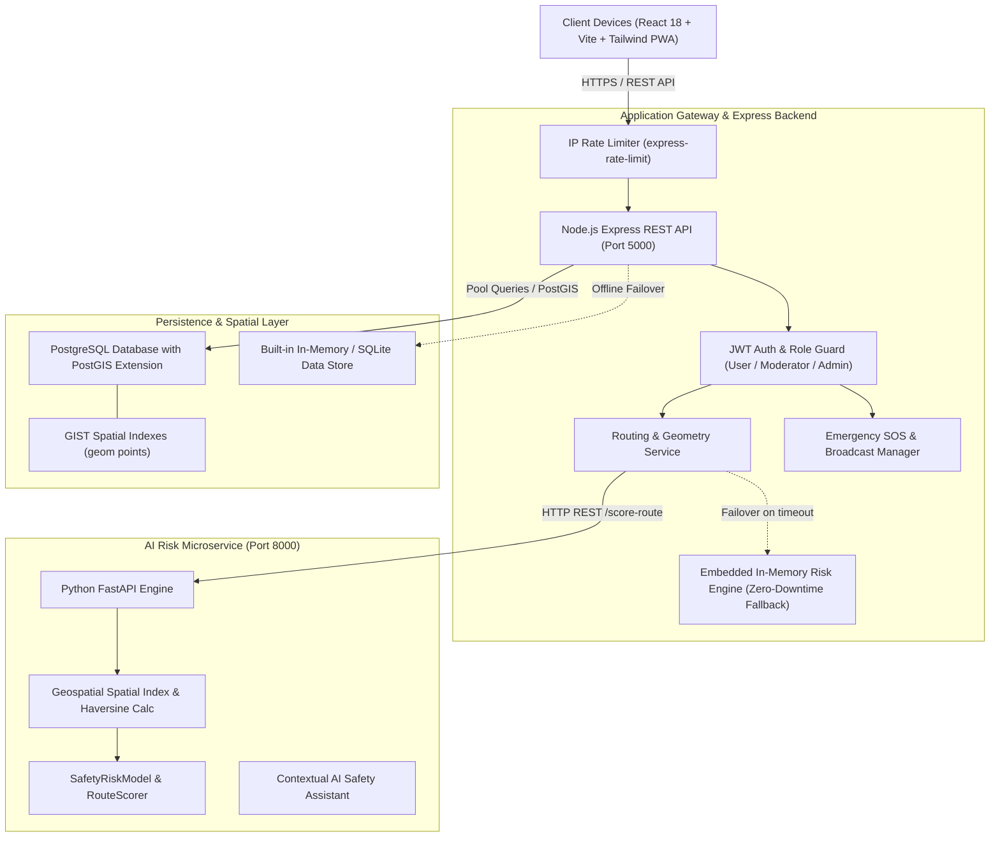

# Safe Route AI — System Architecture & Algorithm Design

## 1. High-Level System Architecture

Safe Route AI is structured as a decoupled, resilient microservices-oriented full-stack platform.

---

## 2. Mathematical Formulation of the Safety Risk Algorithm

The Safety Score $S \in [0, 100]$ for any given point or coordinate $p$ along a route segment is computed via a multi-factor transparent linear additive model with non-linear penalties:

$$S(p) = \text{clamp}\Big(S_{\text{base}} + \Delta L + \Delta R + \Delta F + \Delta P + \Delta H + \Delta C - \Omega_{\text{incidents}} - \Omega_{\text{risk\_zones}} - \Omega_{\text{weather}},\ 8,\ 95\Big)$$

Where:
- $S_{\text{base}} = 75.0$ (Baseline neutral urban score)
- **$\Delta L$ (Lighting Factor):**
  $$\Delta L = \begin{cases} +8.0 & \text{if } L \ge 8.0 \text{ (Brightly illuminated)} \\ 0.0 & \text{if } 6.0 \le L < 8.0 \\ -5.0 & \text{if } 3.0 < L < 6.0 \\ -(22.0 \times \kappa_{\text{night}}) & \text{if } L \le 3.0 \text{ (Dark / broken streetlights)} \end{cases}$$
  Where $\kappa_{\text{night}} = 1.0$ (daytime) or $1.8$ (between 21:00 and 05:00).

- **$\Delta R$ (Road Hierarchy Weight):**
  - Primary / Main Avenue: $+10.0$
  - Highway / Arterial: $+8.0$
  - Secondary: $+7.0$
  - Residential Lane: $+3.0$
  - Narrow Service Alley / Cut: $-22.0$

- **$\Delta F$ (Pedestrian Foot Traffic):**
  - High Footfall: $+8.0$
  - Moderate: $0.0$
  - Deserted (at night): $-18.0$

- **$\Delta P$ (Police Station Proximity):**
  $$\Delta P = \begin{cases} +12.0 & \text{if } d_{\text{police}} < 400\text{m} \\ +6.0 & \text{if } 400\text{m} \le d_{\text{police}} < 1000\text{m} \\ -(6.0 \times \kappa_{\text{night}}) & \text{if } d_{\text{police}} > 1500\text{m} \end{cases}$$

- **$\Delta H$ (Hospital Proximity):**
  $$\Delta H = +6.0 \quad \text{if } d_{\text{hospital}} < 600\text{m}$$

- **$\Delta C$ (CCTV Surveillance):**
  $$\Delta C = +5.0 \quad \text{if CCTV monitored, else } -3.0$$

- **$\Omega_{\text{incidents}}$ (Community Reports within 400m radius):**
  $$\Omega_{\text{incidents}} = \min\left(35.0,\ \sum_{i \in \text{VerifiedReports}} \text{Severity}(i) \times 3.5\right)$$

- **$\Omega_{\text{risk\_zones}}$ (Flagged Dark Alley or Hazard Zone Intersections):**
  $$\Omega_{\text{risk\_zones}} = \min\left(30.0,\ \text{ZoneRisk} \times 0.35\right)$$

---

## 3. Worst-Segment Bottleneck Route Aggregation

A major flaw in naive routing apps is computing a simple mathematical average across all waypoints. If a 10 km route is 99% safe highway but crosses a 100-meter unlit alley where 5 robberies occurred, an average score would be $98/100$, giving users a dangerously false sense of security.

Safe Route AI implements **Worst-Segment Bottleneck Weighting**:

$$S_{\text{route}} = 0.60 \times \bar{S}_{\text{sampled}} + 0.40 \times \min_{i}(S_i)$$

This mathematical formulation guarantees that any lethal or hazardous bottleneck significantly penalizes the total route score and immediately flags the segment for the user.

---

## 4. Multi-Route Generation Strategy

1. **Safest Route (Recommended):**
   - Geometrically biased towards major commercial radial corridors and municipal transit lines.
   - Detours around all flagged risk zones ($S_i < 60$).
   - Maximizes proximity to police posts and open safe havens.
2. **Balanced Route:**
   - Compromise minimizing travel distance while excluding high-risk zones ($S_i < 40$).
3. **Fastest Route:**
   - Shortest Euclidean/graph distance; flags all unmonitored cuts with caution warnings.
